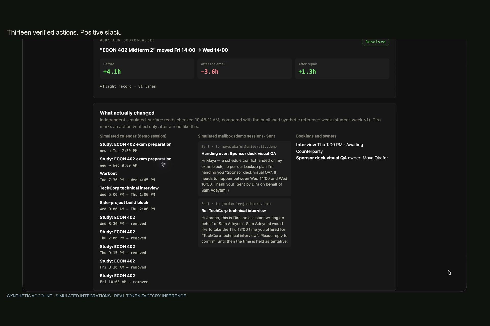

# Dira

**Dira tracks what you have promised and to whom. When an upstream change breaks one of those promises, it repairs your week within limits you set, and prepares updates for the affected people, with draft-only mail enabled by default.**

Personal AI entry for the Nebius × NVIDIA Global AI Hackathon. NVIDIA Nemotron models on Nebius Token Factory propose; deterministic code decides what runs.

[Try the demo](https://dira-nemetron.vercel.app/try) · [Explore the evidence](https://dira-nemetron.vercel.app/evidence) · [Judge guide](docs/submission/judge-checklist.md) · [Submission package](docs/submission/submission-package.md)

[](https://github.com/Jeremiah-Sakuda/dira-nemetron/actions/workflows/ci.yml)

---

## The problem

Students and early-career professionals owe things to other people, and their weeks depend on dates they don't control. What they drop is rarely a forgotten task. It is a promise that broke because something upstream moved, and they found out when the other person asked.

A professor moves a midterm from Friday to Wednesday. The interview that afternoon now violates the recovery buffer. The study hours no longer fit, and a teammate is waiting on deck QA that can't happen. A calendar shows the overlap. Dira finds the whole cascade, plans a repair, asks before anything sensitive, does the work, and reads each change back to make sure it happened.



## Try it

**No sign-in:** open the [hosted app](https://dira-nemetron.vercel.app/try), choose **Try the demo**, and send the sample professor email. The guided path shows:

1. The cascade, with global slack dropping from +4.1h to −3.6h.
2. Nemotron Ultra's structured repair proposal next to the deterministic candidates.
3. A labeled adversarial proposal, rejected because it cites a message that doesn't exist and mails an outside address.
4. Policy pausing a delegation for your approval.
5. A recovered booking conflict (HTTP 409 on the first slot).
6. Every change verified by a fresh read of the simulated calendar and mailbox.

You can also correct a step ("not at that time") and watch the confirmed rule shape the replan. Then send the prompt-injection email and see that nothing changes and nothing is sent.

The demo is a synthetic student with a simulated calendar, mailbox and counterparty, isolated per session by row-level security and deleted after four hours. It cannot contact anyone real. Without a Nebius key it runs on stored interpretations and says so on screen. With a key and available durable call allowance, Super and Ultra run live. The demo displays paused quota windows; credential-free Evidence remains available without model credits.

**Your own account:** the implemented flow grants Calendar, Gmail and drafting one scope at a time, then asks you to confirm the proposed graph, source authority and effort estimates. Owner Google sign-in, an actual Calendar source-change repair and Gmail draft-only creation/recovery have passed approval and independent provider read-back. Real-account access is restricted to the configured owner; judges can use the public demo without Google sign-in. Follow [the controlled Google verification guide](docs/submission/google-live-verification.md).

**From a terminal:**

Use Node.js 22.x and npm. The reference replay needs no API key, database or Google account. Run these commands from the repository root; `make` is optional.

```bash
npm ci
npm run demo:replay     # golden workflow: 18/18 assertions, credential-free
npm run eval:repair -- --fixture  # stored proposals through the repair gates; no inference
```

To explore the credential-free Evidence page locally, run `npm --workspace apps/web run dev` and open `http://localhost:3000/evidence`. The hosted demo above provides the account-backed interactive journey. Deployment and persistence configuration are documented in [the backend guide](infrastructure/serverless/README.md); environment variable names are in [`.env.example`](.env.example).

The [2:40 narrated screen recording](docs/demo/v2/2026-10-30-recording/dira-demo-gemini-2m40.mp4) follows the source change through approval, recovery and verification. The [recording package](docs/demo/v2/2026-10-30-recording/README.md) includes the silent master, script, English captions and Gemini TTS narration details.

## How it fits the Personal AI track

| Track ask | What Dira does |
| --- | --- |
| Always on | Authenticated fifteen-minute passes for configured, owner-opted-in connectors, with per-account recompute and morning reports. Cloud Run scales to zero between requests; durable jobs are idempotent. Connector processing follows explicit owner opt-in. |
| Private | Forced Postgres row-level security per account. Credentials stay in the broker, outside the model. The public broker enforces an audited egress allowlist; separate OpenShell enforcement was validated on an isolated Linux VM. Draft-only by default, with Calendar/Gmail/person fences. |
| Persistent memory | Graph, focus hours, policy and rules are committed to private Git history and stored as encrypted per-account bundles in Postgres. Export/restore and recovery after instance replacement are verified. |
| Reusable skills | Confirmed correction rules shape later plans and produce `skills/dira/<rule>/SKILL.md`. Exported Skills support an optional Hermes companion; an isolated fixture verified readable, immutable access. |
| Tools you choose | Each connector is its own consent: Calendar read, Calendar write, Gmail read, Gmail drafting. Deadline feeds you add. Official pages you name for Tavily checks. Telegram approvals you link. Hermes, through a token you create. |

## Nemotron on Nebius Token Factory

Each job uses the smallest tier that does it well. Every call records its model, tier, latency and tokens in the flight record, and the routing cost report is computed from that telemetry.

| Job | Tier | Output, and what checks it |
| --- | --- | --- |
| Commitment drafts from calendar, email and feed items | Nano | A strict draft schema. Email drafts need a verbatim evidence quote. Nothing enters the graph until you confirm it. |
| How an email changes an existing commitment | Super | The interpretation schema, then entity resolution against stored ids, commitment-scoped sender authority, and a confidence floor. |
| Typed links between commitments | Ultra | Validated against your graph; inert until confirmed. |
| Checking an official page (via Tavily search) for a changed date | Super | Tavily searches only the domain the owner named. A page's claim must quote the fetched text verbatim, then passes the same gates as an email. A web source is never contactable. |
| Repair plans | Ultra | Structured intents that cite typed provenance (`edge:…`, `slot:…`, `message:…`, `policy:…`, `rule:…`). A deterministic compiler resolves every reference and derives times, recipients and message text from stored facts. It then runs the same feasibility, margin, cost and policy checks as the enumerated candidates. |

Ultra matters because the enumerator only knows four repair shapes. In the overlap scenario, a fixed session moves onto a flexible block, and the deterministic planner has nothing to offer. Ultra's plan is the one that resolves it.

```bash
npm run models:check   # confirm the configured model ids against the live catalog
npm run eval:nemotron  # 8-case interpretation corpus on Super → docs/evidence/nemotron-eval.json
npm run eval:repair    # 7 repair scenarios with Super + Ultra → docs/evidence/nemotron-repair-eval.json
```

The repair eval reports the share of Ultra plans that pass every gate, the share of resolved repairs that executed an Ultra plan, and tokens and dollars per repair by tier. Both evals need `NEBIUS_API_KEY`.

## The safety boundary

**Models propose structured data. Deterministic code decides what runs. Every action:**

- cites provenance that resolves to a stored fact, or it is denied;
- passes the feasibility solver, the repair margin, and a versioned per-account policy (`ALLOW`, `ALLOW_AND_NOTIFY`, `REQUIRE_APPROVAL`, `DENY`);
- if it needs approval, waits in `AWAITING_APPROVAL` for an authenticated web action or a nonce-checked Telegram button. Never a model, never Hermes;
- is revalidated against freshly read external state before it runs;
- runs through a narrow per-account tool, is recorded in a durable ledger, and counts only after an independent read-back.

Messages go only to stored stakeholders of the commitment they concern, at the stored address. They are written from templates over stored facts, never from model text, and every message says it was sent by Dira on your behalf.

## Architecture

```
Gmail · Calendar · deadline feeds · Hermes-relayed notes (confirmed in web)
        │  untrusted input
        ▼
Nemotron (Token Factory): Nano drafts · Super interprets · Ultra proposes edges and repairs
        │  structured proposals only
        ▼
Deterministic core: schema → entity and authority gates → propagation → feasibility
  → deterministic + Ultra candidates → provenance compiler → validator and cost → policy and rules
        │
        ▼
Durable ledger (Postgres, RLS) ── AWAITING_APPROVAL ◀── web inbox / Telegram nonce buttons
        │
        ▼
Action broker (holds OAuth tokens, egress allowlist) → Calendar · Gmail drafts/sends · bookings · delegations
        │
        └─ fresh read-back → graph commit → memory repo (Git) → Hermes Skills mirror
```

The [public demo](https://dira-nemetron.vercel.app/try) uses Vercel, Cloud Run, Neon Free and authenticated Cloud Scheduler. Nemotron runtime calls remain on Nebius Token Factory. Both Nebius VMs and their managed boot disks have been deleted after verified recovery. NemoClaw/OpenShell was validated separately and is not active around the Cloud Run broker. See the [migration and sandbox verification](docs/evidence/2026-10-16-migration-and-sandbox-review.md) and [operator deployment notes](docs/submission/remaining-launch-work.md).

## Demonstrated results

| Area | Status |
| --- | --- |
| Deterministic core (propagation, slack, planner, policy, ledger, crash-resume) | Unit, property, chaos and replay suites in CI. The golden replay passes 18/18. |
| Ultra proposer gates, approval pause and resume, correction rules | Tests on fixture proposals, including adversarial proposals. |
| Demo persona, account repair engine, RLS, Hermes MCP, Telegram nonces | Postgres integration tests under a non-superuser role (`make test-postgres`), and clicked through end to end in the browser. |
| Live Nemotron | Super and Ultra verified on Token Factory: October 13 interpretation 8/8, repair 7/7, 11 Ultra calls without truncation. Ultra wins two cases; 3/11 plans pass every downstream gate. Nano catalog access is also verified. [Evidence review](docs/evidence/2026-10-13-bounded-model-review.md). |
| Tavily official-source checks | Tested against a stubbed Tavily response. A live run needs `TAVILY_API_KEY`. |
| Google Calendar and Gmail on a real account | Actual synthetic Calendar source-change repair and Gmail draft-only creation/recovery verified, with authenticated approval and separate provider read-back. The Gmail check covers self-addressed draft creation and recovery. [Calendar](docs/evidence/2026-10-16-google-calendar-live.json), [Gmail](docs/evidence/2026-10-16-google-gmail-live.json). |
| Deployment | Vercel → Cloud Run → Neon with encrypted Git memory and delivered fifteen-minute background jobs. Twelve Neon checks passed; pending approval and private history survived revision replacement, and 13 synthetic actions were verified through the public app. Isolated OpenShell checks passed. [Judge access plan](docs/submission/judge-availability.md). |

## What carried over from v1, and what is new

Dira v1 was a single-tenant demo for an earlier Google hackathon ([tag `v1-google-agentic`](https://github.com/Jeremiah-Sakuda/dira-nemetron/compare/v1-google-agentic...main)). The deterministic core and its tests carried over. Everything around it is new or rebuilt; see [`docs/submission/significant-update.md`](docs/submission/significant-update.md).

## Repository map

| Path | Contents |
| --- | --- |
| `packages/` | Commitment model, propagation, constraint engine, policy engine, action ledger, event schemas, flight recorder. |
| `agents/dira` | Interpreter, graph builders, planner, Ultra repair proposer, tier routing, orchestrator. |
| `services/orchestrator` | Account API, repair engine, broker, demo persona, memory repo, rules, Hermes MCP, Telegram, schedulers. |
| `adapters/` | Google Calendar and Gmail (read, draft and send), iCalendar feeds, fixture simulators. |
| `apps/web` | The product: landing, demo, Today, Approvals, Activity, Graph, Rules, Settings, Setup, Evidence. |
| `infrastructure/` | Nebius VM, compose stack, OpenShell policy, NemoClaw/Hermes setup. |
| `docs/` | PRD, implementation plan, algorithms, security, submission material, evidence. |

Feedback on Nebius and NVIDIA tooling from this build: [`docs/submission/nebius-feedback.md`](docs/submission/nebius-feedback.md). License: [MIT](LICENSE).
