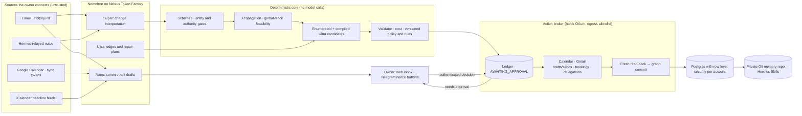

# Architecture

## Main pieces

| Piece | Where | Notes |
| --- | --- | --- |
| Repair engine | `agents/dira/src/orchestrator.ts`, `services/orchestrator/src/account-repair.ts` | Interpret, propagate, plan, approve, execute, verify, replan. Serialized per account; state persists after the mutation and after each verified action. |
| Ultra proposer | `agents/dira/src/repair-proposer.ts` | Structured intents with typed provenance, compiled deterministically. |
| Policy | `packages/policy-engine` | Base verdicts, per-account `REQUIRE_APPROVAL` overrides, and confirmed correction rules. All three can only tighten. |
| Per-account tools | `services/orchestrator/src/account-tools.ts` | Google adapters, or labeled Postgres simulators for demo sessions. |
| Schedule-check broker | `services/orchestrator/src/account-broker.ts` | User-requested Calendar plans, with fresh-read revalidation evidence. |
| Memory | `services/orchestrator/src/account-memory.ts` | A Git repo per account: graph, availability, policy, rules, and `skills/dira/*/SKILL.md`. |
| Hermes and Telegram | `hermes-mcp.ts`, `telegram.ts` | Read-and-report MCP tools; nonce-checked approval buttons. |
| Web | `apps/web` | Proxies to the orchestrator server-to-server, so the session cookie stays on the web origin. |

## Deployment

One Nebius VM runs Postgres, the orchestrator and broker, the web app, Caddy, and the NemoClaw/OpenShell gateway, with one Hermes sandbox per account. See [`../../infrastructure/README.md`](../../infrastructure/README.md). The v1 Google Cloud architecture diagram is kept in `v1/`.
