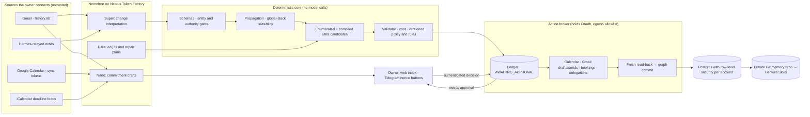

# Architecture

## Main pieces

| Piece | Where | Notes |
| --- | --- | --- |
| Repair engine | `agents/dira/src/orchestrator.ts`, `services/orchestrator/src/account-repair.ts` | Interpret, propagate, plan, approve, execute, verify, replan. Serialized per account; state persists after the mutation and after each verified action. |
| Ultra proposer | `agents/dira/src/repair-proposer.ts` | Structured intents with typed provenance, compiled deterministically. |
| Policy | `packages/policy-engine` | Base verdicts, per-account `REQUIRE_APPROVAL` overrides, and confirmed correction rules. All three can only tighten. |
| Per-account tools | `services/orchestrator/src/account-tools.ts` | Google adapters, or labeled Postgres simulators for demo sessions. |
| Schedule-check broker | `services/orchestrator/src/account-broker.ts` | User-requested Calendar plans, with fresh-read revalidation evidence. |
| Memory | `services/orchestrator/src/account-memory.ts` | A Git repo per account: graph, availability, policy, rules, and `skills/dira/*/SKILL.md`. |
| Hermes and Telegram | `hermes-mcp.ts`, `telegram.ts` | Read-and-report MCP tools; nonce-checked approval buttons. |
| Web | `apps/web` | Proxies to the orchestrator server-to-server, so the session cookie stays on the web origin. |

## Deployment

The public frontend runs on Vercel. A scale-to-zero Cloud Run deployment runs the orchestrator and broker; Neon PostgreSQL holds account-partitioned state, credentials, ledger, workflow records and encrypted private Git memory bundles. An authenticated Cloud Scheduler request runs every fifteen minutes. Both Nebius VMs and their disks were retired after recovery verification. Runtime model calls use Nebius Token Factory.

OpenShell enforcement was verified separately on an isolated Linux VM; it does not surround the public Cloud Run broker. The owner Hermes runtime is unfinished. See the [current operating plan](../submission/judge-availability.md), [readiness tracker](../submission/remaining-launch-work.md), and [three architecture passes](review-2026-10-30.md). Historical Nebius deployment instructions and the v1 diagram remain references, not the current deployment.
